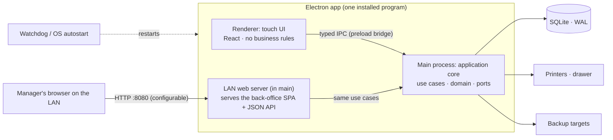
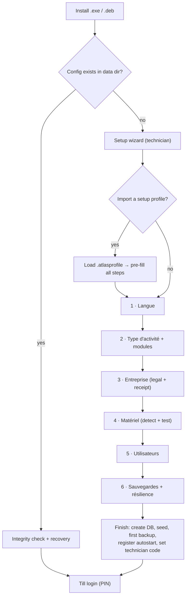
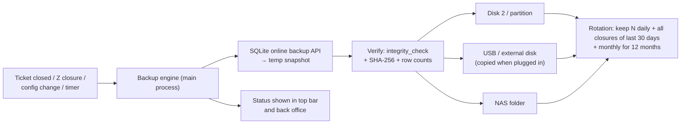

# Atlas POS: design (version 1)

Date: 2026-10-22 · Status: draft for owner review · Owner: Anasse
Mockups: [`docs/mockups/`](../../mockups/), with prompts in `prompts.tsv`.
Background: the Clyo static analysis (`~/Documents/freelance/LC_medical/clyo-analysis/REPORT.md`, "Variant A").

Legend: **[Owner]** decided by the owner in the design conversation · **[Call]** a decision I made, which the owner can overturn · **[Builder]** left to the builder.

---

## 1. Intent

Atlas POS is a **touchscreen point-of-sale app for small businesses in Morocco**. It runs on **one machine** inside the shop and **never needs the internet**.

One installer serves many different businesses. A technician installs it on site and **configures it for that business through a setup wizard**, the way an ERP is configured for a customer: business type, legal info, modules, hardware, users and backups.

Why it exists: today's Windows-only legacy tills (Clyo is the reference studied) are monolithic VB6, hard to adapt and fragile. Atlas POS keeps what those tills do well:

- big touch keys
- fast table service
- full offline operation

It adds:

- a modern clean architecture
- a configuration-driven setup
- Arabic, French and English
- strong protection against power cuts and data loss

**Success looks like this:**

- **Setup:** the technician arrives with a USB key and leaves less than an hour later with a configured, tested till.
- **Power cuts:** the shop survives one without losing a ticket.
- **Recovery:** a dead hard disk is recovered from a backup on another disk.

## 2. Users

| User | Where | Does |
|---|---|---|
| **Technician** [Owner] | On site, at install | Runs the installer and the setup wizard. Later uses the technician menu to reconfigure. Exports and imports setup profiles. |
| **Manager** | Till + LAN web back office | Catalogue, users, reports, backups, discounts beyond the staff limit, cancellations, day closure |
| **Staff** (cashier, waiter) | Till | PIN login, takes orders, payments, prints |

## 3. Goals, non-goals, anti-goals

**Goals (v1, all in the first delivery)** [Owner: "Everything in version 1"]

1. Windows `.exe` installer and a Linux package, plus a 6-step first-run setup wizard.
2. Business templates: **Restaurant, Café/Snack/Fast food, Bakery/Pastry, Retail shop**. Each one switches on a set of modules, and each module can be toggled individually.
3. Till screens for all four business types: floor plan, order pad, counter sale, barcode sale.
4. Payments: **cash, card (standalone terminal) and mixed**, with change calculation and drawer opening [Owner].
5. **Discounts and free items**, line or ticket, % or amount, with a permission and a reason [Owner].
6. Printing: **USB ESC/POS receipt printer + drawer, network ESC/POS kitchen printers (TCP 9100), OS-driver printers** [Owner]. Kitchen routing by category.
7. **Z closure** (day closure) and X report.
8. **LAN web back office** at `http://<till-IP>:<port>` with manager login [Owner]:
   - products and catalogue, with Excel/CSV import and export
   - reports
   - users and settings
   - backups and health
9. **Backups** to a second internal disk, a USB/external disk and a NAS folder [Owner]. A continuous copy after each ticket, plus a full dated backup at each closure, rotated [Owner].
10. **Power-cut resilience**: auto-start with the OS into the till, full restore of open orders, and a recovery screen [Owner].
11. Languages **French, Arabic (RTL) and English** for screens and receipts [Owner].
12. **Technician menu** to change setup after install, with a backup taken first [Owner].
13. **Setup profiles**: export a finished setup (no sales data) and import it to pre-fill the wizard at the next client [Owner].

**Non-goals (v1)**

- Licensing or activation [Owner].
- The cloud, internet sync or multi-shop.
- Integrated card terminals (they are standalone; staff key in the amount).
- French NF525 and any fiscal certification [Owner: Morocco only].
- Customer credit accounts and cash sessions or float counting [Owner: not selected].
- Delivery platforms, loyalty, reservations, hotel software, cash machines, kitchen display screens, handhelds or tablets (those are Variant B).
- Data migration from Clyo [Owner: behaviour reference only].

**Anti-goals: failure even if it "works"**

- Losing or corrupting a closed ticket after a power cut.
- A backup that exists but cannot be restored.
- Configuration hard-coded per client (a fork or code change per business).
- Business rules in the screens, so the till and the web back office disagree.
- Small, fiddly touch targets; any task needing a physical keyboard at the till.
- Copying Clyo's code, schema, images or text. Clyo is a functional reference only [Owner].

## 4. Constraints

- **OS:** Windows 10/11 x64 and Linux (Ubuntu/Debian x64) [Owner]. **[Call]** No 32-bit and no ARM in v1.
- **Hardware assumed:** touchscreen PC, ≥ 4 GB RAM, ≥ 64 GB disk, 1024×768 minimum and 1920×1080 typical. Landscape.
- **Offline:** all features must work with no internet. The LAN is used only for network printers, the NAS and the web back office.
- **Morocco** [Owner]:
  - MAD shown as "38,00 DH".
  - Prices entered **including VAT (TTC)**; VAT rates 20 / 14 / 10 / 7 % and 0 %.
  - Legal fields ICE, IF, RC and Patente on receipts.
- **Languages:** FR, AR (RTL) and EN [Owner]. **[Call]** The UI language is per user; the receipt language is per installation.
- **Framework:** Electron [Owner]. The rest of the stack is in §11.
- **Look:** the mockups' style [Owner: "keep this style"]. No dark mode in v1.

## 5. Architecture

### 5.1 Process layout [Call]



- **One process tree, one database writer.** Only the main process touches SQLite, printers and files. The renderer and the web back office both call the **same use cases**.
- **Renderer hardening:** `contextIsolation`, no `nodeIntegration`, and a preload script exposing a typed API only. Kiosk/fullscreen mode at the till.

### 5.2 Clean architecture layers [Call]

```
src/
  domain/        entities, value objects, domain services, domain events (no I/O, no Electron)
  application/   use cases (commands/queries), ports (interfaces), DTOs, permission checks
  infrastructure/ adapters: SQLite repositories, ESC/POS + OS printing, backup targets,
                 file system, clock, id generator, i18n catalogs, logging
  interfaces/
    ipc/         Electron IPC handlers  -> use cases
    http/        LAN back-office REST API -> use cases
  ui/
    till/        React touch UI (renderer)
    setup/       React setup wizard (renderer)
    backoffice/  React SPA served over LAN
  main.ts        composition root (dependency injection), lifecycle, watchdog
```

**Rules:**

- The domain depends on nothing. Application depends on domain. Infrastructure implements application ports. Interfaces call use cases only.
- Every state change is **one use case = one SQLite transaction**, and it writes a row to an **append-only `event_log`** (who, what, when, before/after).
- **IDs are UUIDv7.** Ticket numbers are a separate, gap-free, per-installation sequence.
- **Patterns:**
  - Repository and Unit of Work (one transaction per use case)
  - Strategy (printer drivers, backup targets, pricing rules)
  - Factory (business templates)
  - Observer/domain events (print on "ticket closed", back up on "ticket closed")
  - Command (use cases)
  - Adapter (hardware)

### 5.3 Modules [Owner list, Call on boundaries]

| Module | Toggle | Contents |
|---|---|---|
| Core | always on | business info, users and permissions, catalogue, VAT, payments, receipts, closure, backups, settings |
| Floor plan (`tables`) | Restaurant default ON | rooms, tables (shape, position, seats), table states, transfer and merge tables, covers |
| Kitchen (`kitchen`) | Restaurant / Café default ON | kitchen tickets, category → printer routing, "send" and "send next course", kitchen messages |
| Menus (`menus`) | Restaurant / Café default ON | set menus with courses and choices; modifiers and options groups |
| Customers (`customers`) | default ON for Restaurant | customer records on a ticket (name, phone, address for delivery tickets), no credit |
| Stock (`stock`) | Retail default ON | stock quantity per product, decrement on sale, low-stock alert, manual adjustment with a reason |
| Barcode (`barcode`) | Retail default ON | EAN on products; keyboard-wedge scanner at the order pad |
| Scale (`scale`) | Bakery default OFF | weight-priced items (price per kg) with **manual weight entry** in v1. **[Call]** Serial scale protocols come later. |
| Order types | per template | Restaurant: Sur place / Emporter / Livraison. Café: Sur place / Emporter with an order number. Retail: direct sale. |

## 6. Installation and first-run setup (the focus)

### 6.1 Packaging [Call]

- **Windows:** electron-builder **NSIS** `.exe`:
  - per-machine install to `C:\Program Files\Atlas POS`
  - data in `C:\ProgramData\AtlasPOS\` (database, logs, config, local backups), never in the install folder
  - Start Menu entry, uninstaller (keeps data unless "remove data" is ticked)
- **Linux:** `.deb` + AppImage. Data in `/var/lib/atlas-pos/` (falling back to `~/.local/share/atlas-pos/`).
- **Unsigned in v1.** The technician gets a note on Windows SmartScreen. **[Builder]** Prepare for code-signing later.
- A **portable USB technician kit** is the installer plus optional setup profile files (`*.atlasprofile`) on the same key.

### 6.2 First launch flow



The steps are fixed and named the same everywhere: **Langue, Type d'activité, Entreprise, Matériel, Utilisateurs, Sauvegardes.** (The mockups vary the names; that is an image-generation artefact.)

| Step | Content |
|---|---|
| 0 · Start | Choose **New installation** or **Import a setup profile**. **[Call]** Also *Restore from a backup*, for disaster recovery onto a new PC. |
| 1 · Langue | UI language for setup; receipt language; default UI language for staff |
| 2 · Type d'activité | 4 template cards → module toggles pre-set by the template (mockup 01). Catalogue source: **template sample products**, **Excel/CSV import** or **empty** (managed later in the web back office) [Owner] |
| 3 · Entreprise | Raison sociale, nom commercial, address, city, phone, **ICE, IF, RC, Patente**, logo, currency (MAD fixed in v1), VAT rates, receipt header and footer, live 80 mm receipt preview (mockup 02) |
| 4 · Matériel | Detect USB/serial printers and OS printers. Add network printers by IP:port. **Test print** per printer. **Open drawer** test. Paper width 58/80 mm. Category → printer routing. Barcode scanner test field. Customer display (2nd screen) optional (mockup 03) |
| 5 · Utilisateurs | Manager account (PIN for the till, plus username and password for the web back office). Staff with PIN and permission profile. Default profiles: *Gérant*, *Caissier*, *Serveur*. **Technician code** (separate secret). |
| 6 · Sauvegardes | Destinations: second internal disk/partition, USB/external disk, NAS (SMB path or mounted folder), each with a **Test** (write, read, verify). Schedule: continuous + at closure, retention (default 30 daily). Resilience: auto-start with the OS, kiosk mode, recovery screen (mockup 04). **Technician checklist** (displayed, not automated): BIOS "power on after AC loss", OS auto-login for the till user, disable sleep. |
| Finish | Writes the config, creates and seeds the DB, runs the first full backup to every destination, registers auto-start, shows a summary, and offers to export this setup as a profile |

Other wizard rules:

- Every step validates before "Suivant".
- The wizard state is saved after each step, so a power cut during setup resumes where it stopped. **[Call]**
- Before an Excel/CSV import is committed, a preview shows mapped columns and rows with errors.

### 6.3 Configuration model [Call]

- **Templates** are versioned JSON files shipped in the app: `templates/restaurant.json`, `cafe.json`, `bakery.json`, `retail.json`. Each holds the module toggles, default settings, sample catalogue, default printers routing, default keyboard layout and default profiles.
- **Settings registry:** every setting is declared once in code with key, type, default, scope (installation/user), validation schema, label i18n key and who may change it. The wizard, technician menu and back office render forms from that registry. Settings are stored in a `settings` table and versioned (a change is written to `event_log`).
- **Setup profile** (`.atlasprofile`):
  - a zipped JSON containing templates applied, settings, catalogue, keyboard layouts, printers (without machine-specific device paths), profiles and permissions
  - **no** sales, users' PINs or passwords
  - a schema version, so newer apps can import older profiles
- **Technician menu:** opened from the till by a long press on the logo plus the technician code. It can:
  - re-run any wizard step
  - switch modules
  - edit hardware
  - export or import a profile
  - view logs
  - restore a backup

  A full backup is always taken before applying changes.

## 7. Resilience: power cuts and data safety

### 7.1 Database [Call]

- SQLite with `journal_mode=WAL` and `synchronous=FULL`: every committed transaction is on disk before the use case returns.
- `foreign_keys=ON`.
- Each user action is one transaction. **Open orders are persisted line by line** (adding an item writes immediately), so a power cut loses at most the tap in progress.
- **On every start:**
  1. Run `PRAGMA quick_check`.
  2. If it fails, run a full `integrity_check`.
  3. If that fails, enter **recovery mode**: offer the latest verified backup and keep the damaged file aside.
- Closed tickets are **immutable**. A correction is a new cancellation or refund ticket that references the original, with permission and a reason.
- Ticket numbers are gap-free and allocated inside the closing transaction.
- Reprints are marked "DUPLICATA".

### 7.2 Backups [Owner targets and schedule; Call on mechanics]



- **Continuous:** after each closed ticket, debounced to at most one snapshot per 60 s, to a rolling `live` copy on each available destination.
- **Full:** at each Z closure, a dated, verified copy (`atlas-YYYYMMDD-HHMM-Z<no>.atlasbak`: compressed SQLite snapshot + manifest JSON with checksum, app version and schema version). Also before any migration, restore or technician change.
- **Unavailable destinations** (USB not plugged in, NAS down): queued, retried, and the backup copied when the destination returns. After 24 h without a successful copy to a destination, an **amber warning** appears on the till top bar and in the back office.
- **Restore:** manager or technician only, from the technician menu or back office. Pick a backup, verify it, then swap the DB file. The current DB is kept as `pre-restore-*`.
- **Encryption** of backups: **[Call]** not in v1, since LAN only. They are compressed and checksummed. **[Builder]** Leave a hook for encryption.

### 7.3 Power-cut restart [Owner: auto-restart into the till]

- Auto-start at OS login: Windows startup entry (or a scheduled task), Linux XDG autostart. Single-instance lock.
- A **watchdog** (a small supervisor process started first) relaunches the app if it crashes. After 3 crashes in 5 minutes it shows a safe-mode screen with "restore backup" and "send logs".
- **On start after an unclean shutdown**, detected by a `running.lock` file still present:
  1. Integrity check.
  2. Restore open tables and orders exactly.
  3. Show the **recovery screen** (mockup 08) with the checks, restored tables, last backup time and "no ticket lost".
  4. Continue to PIN login.
- Printing during a cut: a print job is a persisted queue row. Unconfirmed jobs are shown as "à réimprimer ?" after restart, never re-printed silently.

## 8. Till features (v1)

Common to all business types:

- **PIN login** with user switching. Auto-lock after inactivity [Call: 2 min, configurable].
- **Order pad** (mockup 06):
  - ticket panel, coloured category tabs, product keys grid, quantity keypad
  - modifiers and options popup, free-text note per line
  - search
  - ticket panel side **configurable** (left or right) [Owner]
  - product keys **configurable per business** (colour band or photo; colour when no photo) [Owner]
- **Keyboard pages:** the layout of categories and keys is editable in the back office (order, colour, size 1×1 / 2×1).
- **Payments:**
  - cash (amount tendered, change, quick-cash buttons)
  - card (standalone: confirm the amount was taken)
  - other methods configurable (cheque, voucher)
  - mixed payments on one ticket; split bill by items or equal parts (Restaurant)
- **Discounts and free items** (line or ticket, % or fixed). Per-profile max % and reason list. Above the max, a manager PIN is required.
- **Cancellations:** remove a line before sending (free) or after sending (permission + reason, kitchen "ANNULÉ" ticket). Cancel or refund a closed ticket (manager).
- **Parked tickets** (mise en attente), reprint, duplicate.
- **X report** (current day) and **Z closure**:
  - totals by payment method, VAT breakdown, category, staff, discounts, cancellations
  - printed and stored
  - blocks further sales on that business day until reopened as a new day
- **Top bar:** business name, user, clock, **backup status indicator**, printer status.

Per business type:

| Type | Screens |
|---|---|
| **Restaurant** | Floor plan with rooms as tabs (mockup 05); table states free / occupied (covers, elapsed, amount) / bill requested; open table → order pad; covers; transfer and merge tables; send to kitchen, send next course; set menus by course; takeaway and delivery tabs |
| **Café / Snack** | Floor plan by default (Salle, Terrasse): the waiter serves at the table, the order goes to the bar/kitchen, the **addition** is printed and the customer **pays when leaving**. "Vente directe" opens the counter pad: Sur place / Emporter toggle, **order number** printed on receipt and kitchen ticket; on a counter order, "Addition" prints the bill and parks the order until it is paid |
| **Bakery / Pastry** | Fast counter pad, large keys; weight items with **manual kg entry** × price/kg; no tables |
| **Retail** | Barcode-first sale screen (scan adds a line, unknown barcode → quick-create by a manager); product search; stock levels shown; low-stock list |

## 9. Printing [Owner printer types; Call on mechanics]

- **Drivers (Strategy):** `EscPosUsb` / `EscPosSerial`, `EscPosNetwork` (raw TCP 9100) and `OsDriver` (system printer via Electron `webContents.print`, for A4 or unsupported models).
- **Receipts rendered from templates:** header (logo, legal fields), lines, VAT breakdown, payments, footer. 58 and 80 mm.
- **Arabic receipts:** many ESC/POS printers have no Arabic code page or shaping. **[Call]** Arabic (and optionally all) receipts are rendered as a **raster image** (HTML → bitmap → ESC/POS raster), so they print the same on any printer. Text mode is kept for speed when the language is FR/EN and the printer supports it.
- **Kitchen tickets:** large font, table/order number, covers, time, waiter, items grouped by course, modifiers, notes. Routed by **category → printer**. Reprint and "ANNULÉ" tickets.
- **Drawer:** an ESC/POS pulse through the receipt printer, on cash payment and on manager request (logged).
- **Print queue** persisted in SQLite with retry and an error banner ("Imprimante cuisine hors ligne").

## 10. LAN web back office [Owner]

- Served by the main process on `0.0.0.0:<port>` (default 8080, set in the wizard). **[Call]** It refuses non-private IPs, and a "LAN only" switch can turn it off entirely.
- **Login** with username and password (scrypt or argon2 hash). Lockout after 5 failures for 15 min. Session cookie (HttpOnly, SameSite=Strict) and CSRF token. Manager role only in v1. **[Call]** Plain HTTP on the LAN in v1; HTTPS with a self-signed certificate is an option.
- **Sections** (mockup 09):
  - Tableau de bord: today's sales, backup and printer health
  - Produits, with Excel/CSV import and export
  - Catégories
  - Menus and options
  - Claviers (key layouts)
  - Utilisateurs and permission profiles
  - Imprimantes and routing
  - Sauvegardes: status, download, restore
  - Rapports: by day, period, product, category, staff, payment method; Z history; export Excel/CSV
  - Paramètres: business info, receipt, VAT
  - Journal (event log and errors)
- Edits take effect at the till immediately. The till listens to change events from the core.

## 11. Technology [Owner: Electron; the rest Call]

| Concern | Choice |
|---|---|
| Shell | Electron (current LTS), electron-builder |
| Language | TypeScript (strict) everywhere |
| UI | React + Vite; CSS with design tokens and logical properties (RTL); a touch component kit in-repo |
| State in the UI | TanStack Query over IPC/HTTP; no business state in the UI |
| Database | SQLite via `better-sqlite3`; migrations versioned in code; Kysely or Drizzle for typed queries |
| Web server | Fastify, inside the main process |
| Validation | Zod schemas, shared by IPC, HTTP and the settings registry |
| i18n | i18next, with FR/AR/EN catalogues; `dir="rtl"` for Arabic |
| ESC/POS | Own small encoder plus raster rendering; `serialport` and USB via the OS printer port, or `usb` where needed **[Builder]** |
| Excel/CSV | SheetJS (xlsx) |
| Logging | pino → rotating files in the data dir |
| Tests | Vitest (domain and application), Playwright for Electron (wizard and till flows), crash tests (kill -9 during writes) |
| Images | Generated with Codex CLI image tool [Owner]: template sample product photos, empty-state and wizard illustrations, app icon. Provenance JSON per image; images are illustrations, replaceable by the business's own photos. |

## 12. Look and feel [Owner: keep the mockup style]

- **Tokens:**
  - background #F4F5F7, top bar navy #14213D, action teal #0FA3A3, warning amber #F2A541, error red, success green
  - white cards with 14 px radius and soft shadow
  - one bold geometric sans-serif; **[Builder]** pick an open font with Arabic coverage (e.g. a Latin + Arabic pairing)
- **Touch rules:** min target 64 px at the till (72 px primary); no hover-only actions; long-press only for secondary actions; on-screen keyboard and numeric keypad for every input at the till.
- **Mockups** are the reference for layout, not pixel-perfect: 01–04 the wizard, 05 the floor plan, 06 the order pad, 07 Arabic RTL, 08 recovery, 09 the back office.

## 13. Clyo as a behaviour reference (from REA)

Clyo's screens (`caisse.exe` had 136 forms, `carte.exe` 81) were used as a checklist. Nothing is copied.

| Clyo feature (form or table seen) | Atlas v1 |
|---|---|
| Floor plan, table occupancy, covers, table transfer (`frm_plan_de_salle`, `tbl_occupation`) | ✅ |
| Order pad, keyboard pages, button placement (`tbl_clavier`, `section`, `tbl_placement_bouton`) | ✅ editable layouts |
| Modifiers and option groups, set menus by course (`frm_groupe_options`, `tbl_menu_et_niveau_de_plat`) | ✅ |
| Send next course (`tbl_asuivre`) | ✅ manual "send next" (no timers) |
| Split bill (`frm_part_note`, `note_*`) | ✅ |
| Discounts (`frm_remise*`) | ✅ with permissions |
| Payment methods incl. mixed (`tbl_les_reglement`) | ✅ cash/card/configurable; no vouchers integration |
| Parked tickets (`frm_ticket_en_attente`) | ✅ |
| Kitchen printer routing (`tbl_imprimantes`, `tbl_profils_impr`) | ✅ |
| Permission profiles (100-char bit string in `tbl_profils`) | ✅ redesigned as named permissions |
| Day closure, X/Z reports, statistics (`tbl_cloture`, `statistique.exe`) | ✅ |
| Stock: products, adjustments | ✅ basic (no suppliers, purchases, recipes) |
| Customers on ticket and delivery address | ✅ without credit |
| Cash float and counting (`frm_fond_de_caisse`, `frm_comptage_caisse`) | ❌ [Owner] |
| Customer accounts and credit (`frm_compte_client`) | ❌ [Owner] |
| Loyalty, subscriptions, gift vouchers, reservations, time clock | ❌ later |
| Delivery platforms, kiosk, handhelds, kitchen display, cash machines, terminals, hotel software | ❌ later (Variant B/C) |
| NF525 signatures and archives | ❌ [Owner: Morocco only], but closed-ticket immutability and the event log keep the door open |

## 14. Testing and acceptance

The **acceptance tests** below come from the owner's goals.

1. **Fresh install on Windows and on Linux:** the wizard completes for each of the 4 templates; test prints and drawer work with a real or virtual ESC/POS printer.
2. **Profile round trip:** export a setup profile, install on a second machine, import it; the result is identical except for the hardware paths.
3. **Power cut:**
   - Kill the process (and, on a VM, hard power-off) during order entry, during payment and during a backup.
   - After restart, integrity is OK, open orders are restored and no closed ticket is lost or duplicated.
   - Run it 50 times automated.
4. **Backup:**
   - Each destination is tested.
   - USB unplugged for 24 h → warning shown; plugged in → copy made.
   - A restore from each destination gives the same data (row counts and checksums).
5. **Arabic:** the UI is fully RTL, and receipts print correctly as a raster on a printer without Arabic support.
6. **Back office:** login, lockout, product CRUD, Excel import with errors, reports match the Z ticket totals.
7. **Permissions:** staff cannot exceed the discount limit, cancel closed tickets, open the technician menu or restore.

## 14b. Decisions settled after the builder check [Call, owner asleep: please review]

The owner asked for autonomous completion, so these were decided without asking:

1. **Multilingual catalogue: yes.**
   - Products, categories, modifiers, options and set menus carry `name_fr` (required), `name_ar` and `name_en` (optional). An empty value falls back to French.
   - The till shows names in the current user's UI language. Receipts use the installation's receipt language.
   - **Kitchen tickets use a language set per printer**, defaulting to the receipt language.
   - Excel/CSV import and export use the columns `name_fr`, `name_ar` and `name_en`.
2. **Business day = the period between two Z closures, not the calendar date.**
   - A day opens automatically with the first sale after the previous Z.
   - Several Z closures in one calendar date are allowed.
   - If a day has been open for more than 24 h, or has crossed the configurable cut-over hour (default 05:00), the till shows a blocking prompt: "Clôturez la journée précédente". It does not auto-close.
   - A refund or cancellation counts in the business day in which it is made, referencing the original ticket.
   - **Ticket numbers never reset.** There is one gap-free sequence per installation for sale tickets, and a separate gap-free sequence for credit notes (`AV-000001`).
   - The **Café/Snack order number** is a separate counter allocated when the order is created (1 to 999, wrapping), reset at each new business day.
3. **Invoice (facture) for business customers: yes, basic.**
   - A manager can turn a closed ticket into an A4 invoice for a customer with company name, address and **ICE**.
   - It has its own gap-free sequence `F-YYYY-NNNNN`, is printed through the OS driver or saved as PDF, and cannot be edited.
   - The customers module gains company name, ICE and an "entreprise" flag.
4. **Customer display: yes, simple.**
   - If a second monitor is detected and enabled in step 4, a second full-screen window shows the current ticket lines and total.
   - It shows the business logo when idle, mirrored for RTL.
5. **Build order (no deadline given):**
   - Shared core, resilience and backups first.
   - Then the installer and setup wizard (the owner's stated focus).
   - Then the order pad and payments common to all types.
   - Then Restaurant, Café, Bakery, Retail.
   - Then the web back office, reports and invoice.
   - Each step is committed and tested before the next.

## 15. Left to the builder

- Exact folder names inside the layers.
- The ORM choice (Kysely vs Drizzle).
- Component library internals.
- Exact report layouts.
- The font pairing.
- The USB printer access method per OS.
- Retry and backoff values.
- Log retention.
- Exact debounce timings within the stated bounds.
- The installer UI wording.

## 16. Owner decisions recorded

Setup by the technician only · 4 business types · Windows + Linux · FR/AR/EN · Backups to disk 2, USB and NAS · Continuous + daily backups · Auto-restart into the till after a power cut · Morocco only · All 3 printer types · Wizard covers business/legal, template/modules, hardware, users/backups · Catalogue from template, Excel/CSV or LAN web back office · No licence · Back office has catalogue, reports, users/settings, backups/health · Payments cash/card/mixed + discounts/free items · Clyo as behaviour reference only · Project in `~/Projects/atlas-pos` · Name "Atlas POS" · Web login with username + password · Keep the mockup style · Keys configurable (colour/photo) · Ticket side configurable · Everything in v1 · Technician menu · Setup profiles · Images via Codex CLI.
